# Electric Cooperative Billing System

A Java Swing desktop application that manages electricity accounts and computes monthly bills. Accounts are stored in a MySQL database, so they are still there the next time you open the program.

_**Group C**_

**Course / Section:** _BSIT2HG2_

---

## Table of Contents

1. [Features](#1-features)
2. [Requirements](#2-requirements)
3. [Installation](#3-installation)
4. [Project Structure](#4-project-structure)
5. [User Manual](#5-user-manual)
6. [Billing Rules](#6-billing-rules)
7. [Input Validation](#7-input-validation)
8. [Troubleshooting](#8-troubleshooting)
9. [OOP Concepts Used](#9-oop-concepts-used)
10. [Known Limitations](#10-known-limitations)

---

## 1. Features

| Area | What you can do |
|---|---|
| **Consumers** | Add, update, and delete Residential and Commercial consumers |
| **Public Facilities** | Add, update, and delete public facilities (for example, a barangay hall) |
| **Billing** | Enter a meter reading for any account and compute its bill. Every reading and its total bill is saved in MySQL |
| **Database** | Accounts, meter readings, and computed bills are saved in MySQL and loaded automatically when the app starts |
| **Automatic IDs** | MySQL creates the ID, shown as `C-0001` for consumers and `PF-0001` for facilities |
| **Duplicate protection** | The same name and address (or name and agency) cannot be saved twice |
| **Validation** | Empty fields and invalid readings are rejected with a clear message |

---

## 2. Requirements

| Software | Version | Purpose |
|---|---|---|
| Java JDK | 17 or later (developed on JDK 25) | Compile and run the program |
| IntelliJ IDEA | Any recent version (Community is enough) | Editor and runner |
| MySQL Server | 8.0 | Database |
| MySQL Workbench | 8.0 | Create and view the database |
| MySQL Connector/J | 8.x (Platform Independent ZIP) | Lets Java talk to MySQL |

Tested on Windows.

---

## 3. Installation

### Step 1: Install MySQL

1. Install **MySQL Server 8.0** and **MySQL Workbench** using the MySQL Installer.
2. During setup, set a password for the `root` user and remember it.
3. Make sure the MySQL service is running. Press `Win + R`, type `services.msc`, find **MySQL80**, and check that its status is **Running**.

### Step 2: Create a connection in MySQL Workbench

1. Open Workbench and click the **+** next to **MySQL Connections**.
2. Fill in:
   - **Hostname:** `127.0.0.1`
   - **Port:** `3306`
   - **Username:** `root`
3. Click **Test Connection**, enter your password, then click **OK**.

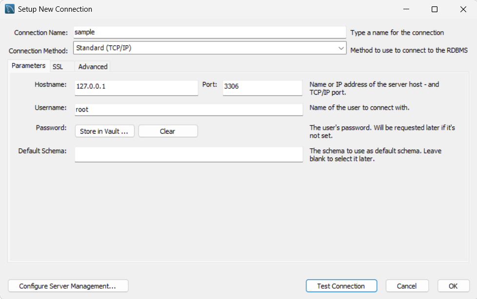

### Step 3: Create the database and tables

Open the connection, paste this into a query tab, and run all of it (`Ctrl+Shift+Enter`):

```sql
CREATE DATABASE IF NOT EXISTS sample_db;
USE sample_db;

CREATE TABLE consumers (
    consumer_id INT PRIMARY KEY AUTO_INCREMENT,
    consumer_name VARCHAR(100) NOT NULL,
    consumer_address VARCHAR(150) NOT NULL,
    type VARCHAR(20) NOT NULL,
    CONSTRAINT uq_consumer UNIQUE (consumer_name, consumer_address)
);

CREATE TABLE public_facilities (
    facility_id INT PRIMARY KEY AUTO_INCREMENT,
    facility_name VARCHAR(100) NOT NULL,
    agency VARCHAR(100) NOT NULL,
    CONSTRAINT uq_public_facilities UNIQUE (facility_name, agency)
);

CREATE TABLE meter_readings (
    reading_id INT PRIMARY KEY AUTO_INCREMENT,
    consumer_id INT NULL,
    facility_id INT NULL,
    previous_reading DECIMAL(10,2) NOT NULL,
    current_reading DECIMAL(10,2) NOT NULL,
    reading_date DATE NOT NULL,
    total_bill DECIMAL(12,2) NOT NULL,
    FOREIGN KEY (consumer_id) REFERENCES consumers(consumer_id) ON DELETE CASCADE,
    FOREIGN KEY (facility_id) REFERENCES public_facilities(facility_id) ON DELETE CASCADE
);
```

Each row of `meter_readings` belongs to either a consumer or a facility. When an account is deleted, its readings are deleted with it.

Refresh **Schemas** on the left. You should see `consumers`, `public_facilities`, and `meter_readings` under `sample_db` > **Tables**.


### Step 4: Get the project

1. Copy all the `.java` files into the `src` folder of an IntelliJ project (see [Project Structure](#4-project-structure)).
2. Open the project in IntelliJ IDEA.

### Step 5: Add the MySQL Connector/J library

1. Download **Connector/J** from the MySQL website. Choose **Platform Independent** and download the **ZIP** archive, then extract it.
2. In IntelliJ, open **File > Project Structure** (`Ctrl+Alt+Shift+S`).
3. Click **Libraries**, then **+ > Java**.
4. Select the file `mysql-connector-j-x.x.x.jar` inside the extracted folder.
5. Click **OK**, then **Apply > OK**.

The JAR should now appear under **External Libraries**.

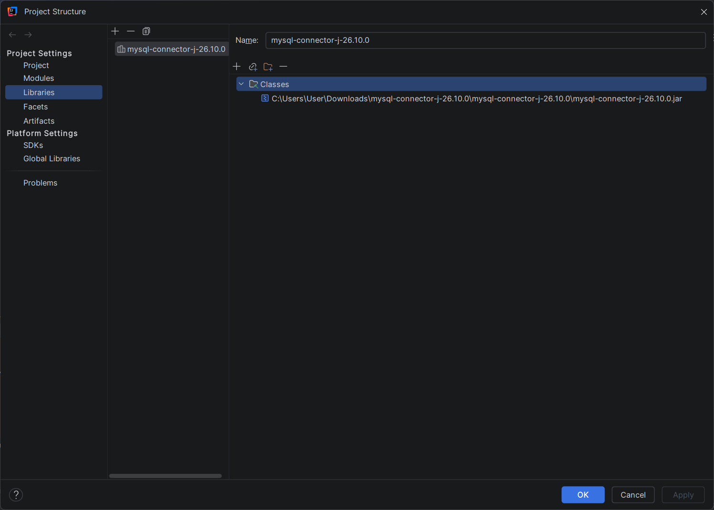

### Step 6: Set your database password

Open `DatabaseHelper.java` and change these lines at the top to match your MySQL setup:

```java
private static final String URL  = "jdbc:mysql://localhost:3306/sample_db";
private static final String USER = "root";
private static final String PASS = "your_password_here";
```

> Do not share or upload the project publicly with your real password inside.

### Step 7: Run the program

1. Open `Main.java`.
2. Click the green **Run** button (or press `Shift+F10`).
3. The **Electric Cooperative Billing System** window opens.

---

## 4. Project Structure

```
src/
├── Billable.java          Interface: anything that can be billed
├── Consumer.java          Abstract class for consumers
├── Residential.java       Consumer type with the residential rate
├── Commercial.java        Consumer type with the commercial rate
├── PublicFacility.java    Government facility (billed with a discount)
├── MeterReading.java      Previous and current reading, and the consumption
├── DatabaseHelper.java    All MySQL code (accounts, readings, and bills)
├── Main.java              The Swing GUI (run this file)
├── Tester.java            Console test program (optional)
└── Payment.java           Payment class (not used by the GUI)
```

---

## 5. User Manual

The window has three tabs: **1. Consumers**, **2. Public Facilities**, and **3. Billing**.

### 5.1 Consumers tab

Manages Residential and Commercial consumers.

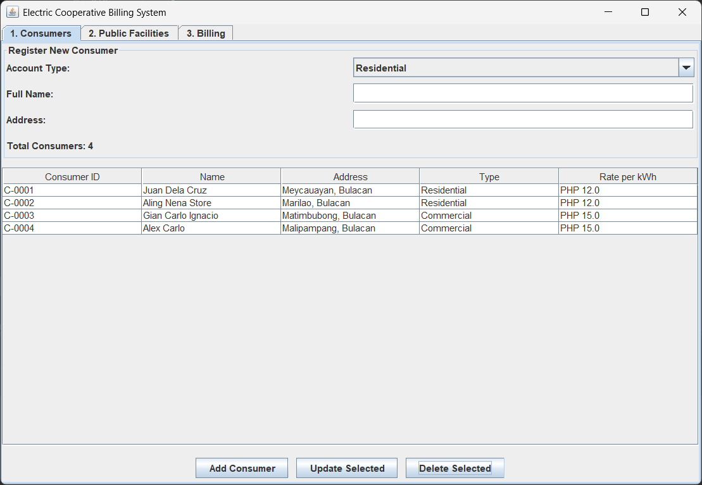

**Add a consumer**

1. Choose the **Account Type**: Residential or Commercial.
2. Type the **Full Name** and the **Address**.
3. Click **Add Consumer**.
4. A message shows the new ID, for example `C-0001`, and the consumer appears in the table.

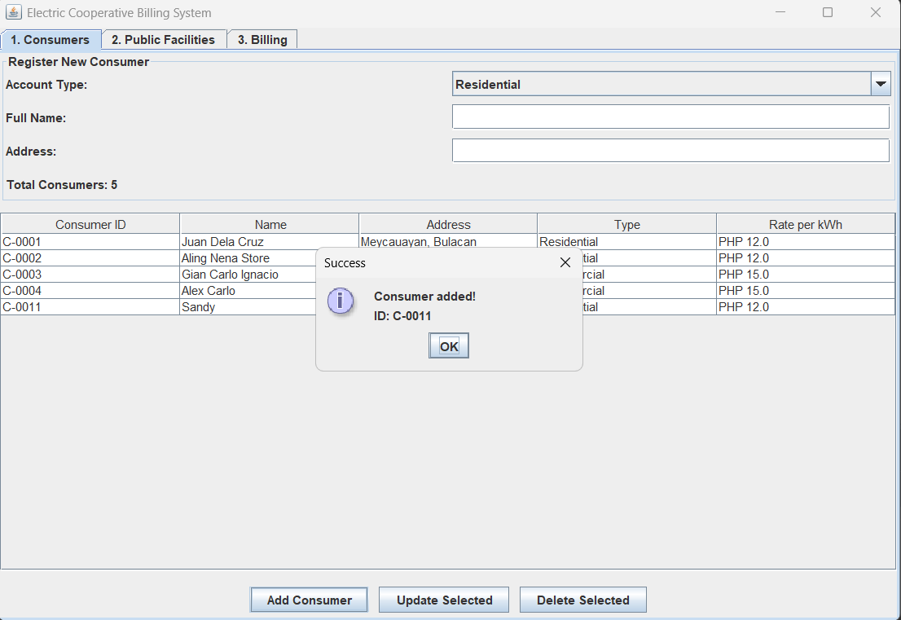

**Update a consumer**

1. Click a row in the table.
2. Click **Update Selected**.
3. In the form, change the **Type**, **Name**, or **Address**, then click **OK**.

The ID cannot be changed. Changing the type between Residential and Commercial also changes the rate used for billing.

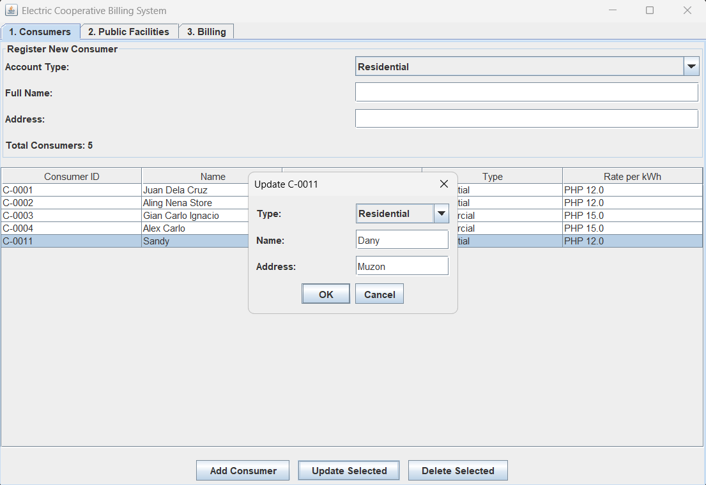

**Delete a consumer**

1. Click a row in the table.
2. Click **Delete Selected**.
3. Confirm with **Yes**. The consumer is removed from the table and from MySQL.

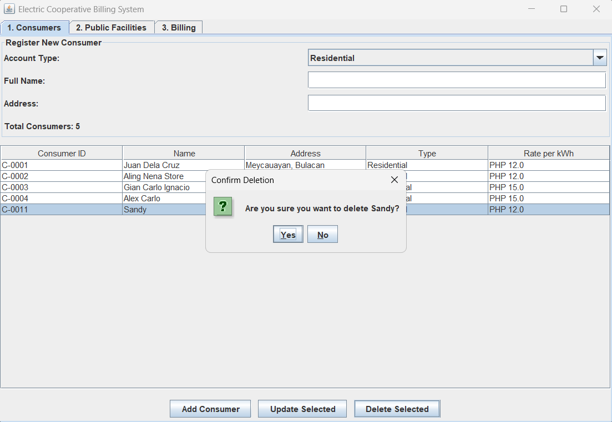

### 5.2 Public Facilities tab

Manages government facilities such as a barangay hall.

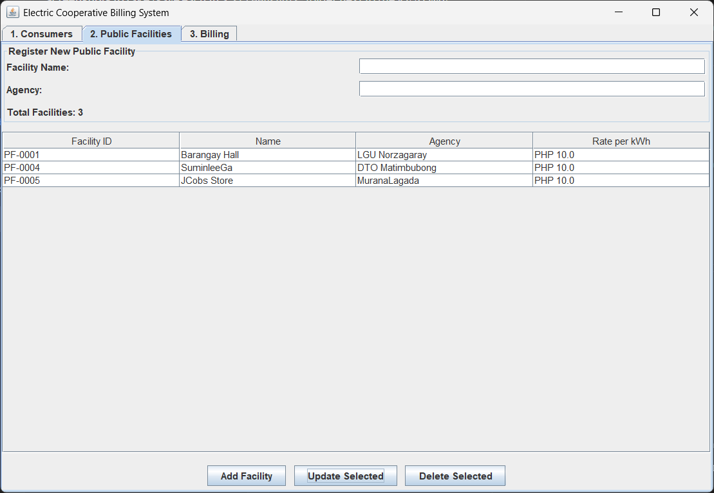

**Add a facility**

1. Type the **Facility Name** and the **Agency**.
2. Click **Add Facility**.
3. A message shows the new ID, for example `PF-0001`.

**Update a facility**

1. Click a row in the table, then click **Update Selected**.
2. Change the **Name** or **Agency**, then click **OK**.

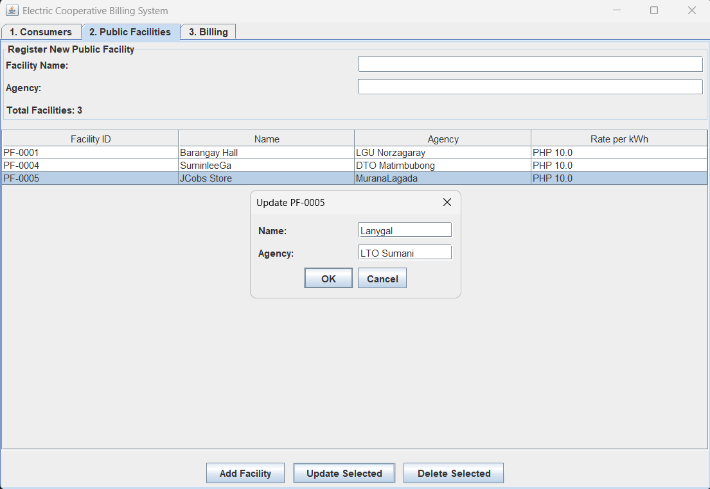

**Delete a facility**

1. Click a row, then click **Delete Selected** and confirm with **Yes**.

### 5.3 Billing tab

Computes a bill from a meter reading. The table lists every account (consumers and facilities).

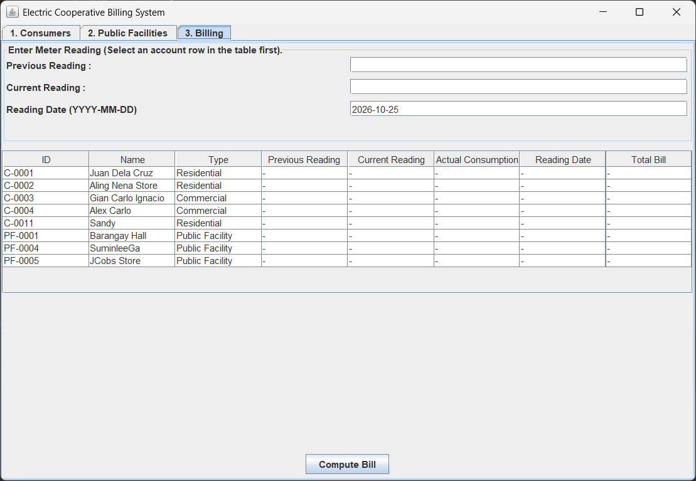

**Compute a bill**

1. Click the account you want to bill in the table.
2. Enter the **Previous Reading** and the **Current Reading** (numbers, in kWh).
3. Check the **Reading Date**. It starts as today's date. Use the format `YYYY-MM-DD`.
4. Click **Compute Bill**.
5. A window shows the account, the readings, the consumption, and the **Amount due**. The table row is also filled in with the readings and the total bill.
6. The reading and the bill are saved in MySQL. Each time you compute a bill for the same account, a new record is added, and the table shows the **latest** one. When you reopen the program, the latest reading of each account is loaded back.

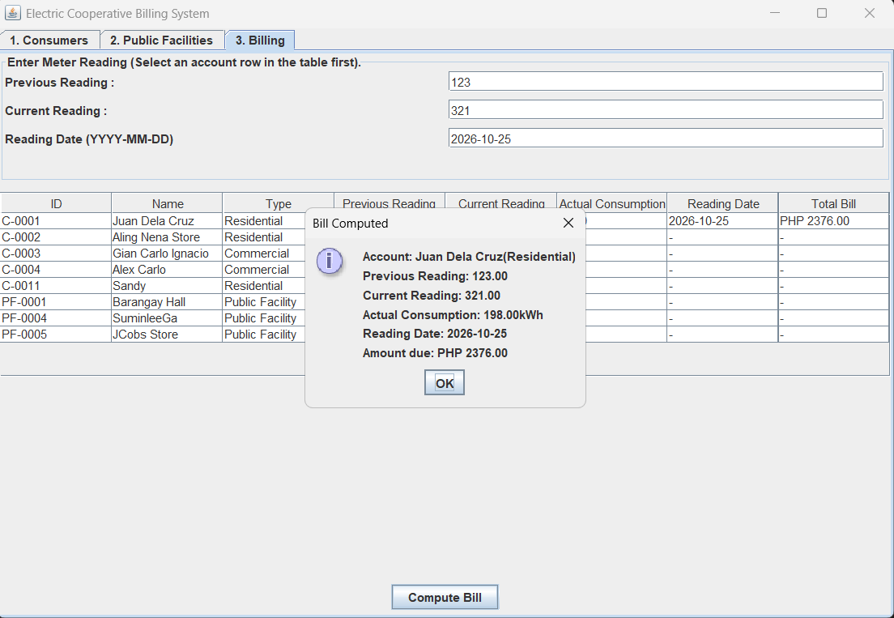

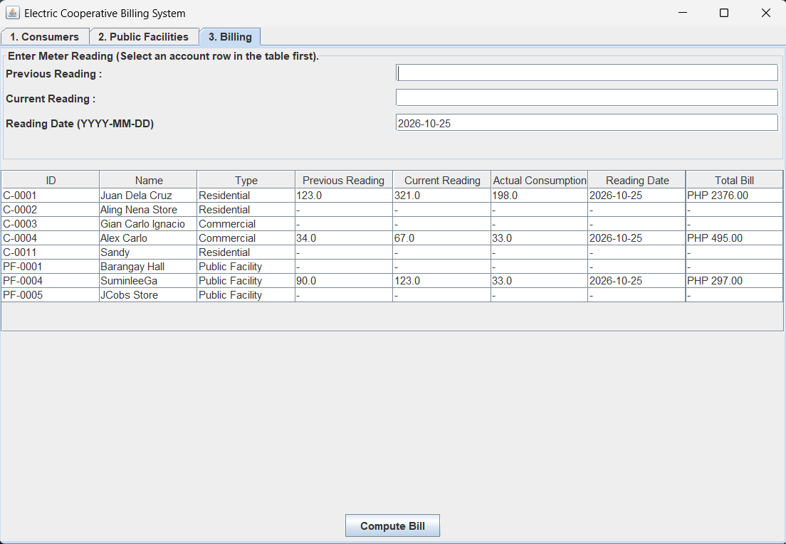

### 5.4 Error messages

When something is wrong, the program shows a message instead of closing.

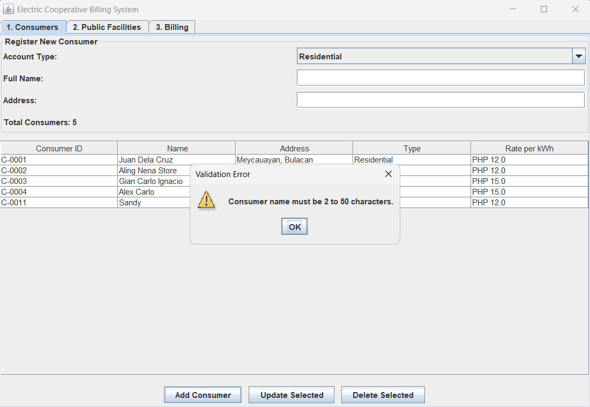

| Message type | Meaning |
|---|---|
| **Warning** | You did not select a row first |
| **Validation Error** | A field is empty or a reading is not allowed |
| **Input Error** | A reading is not a valid number |
| **Database Error** | MySQL rejected the action, for example a duplicate account |

---

## 6. Billing Rules

Bill = **consumption** x **rate per kWh**, where consumption = current reading - previous reading.

| Account type | Rate per kWh | Extra |
|---|---|---|
| Residential | PHP 12.00 | None |
| Commercial | PHP 15.00 | None |
| Public Facility | PHP 10.00 | 10% government discount on the total |

**Example:** previous 100, current 180 gives a consumption of 80 kWh.

| Account type | Computation | Amount due |
|---|---|---|
| Residential | 80 x 12.00 | PHP 960.00 |
| Commercial | 80 x 15.00 | PHP 1,200.00 |
| Public Facility | (80 x 10.00) - 10% | PHP 720.00 |

---

## 7. Input Validation

- Names, addresses, facility names, and agencies **cannot be empty**.
- Meter readings **cannot be negative**.
- The current reading **cannot be lower** than the previous reading.
- The reading date must be a real date in `YYYY-MM-DD` format, for example `2026-10-25`.
- The same **name and address** cannot be saved twice for consumers.
- The same **facility name and agency** cannot be saved twice for facilities.

---

## 8. Troubleshooting

| Problem | Likely cause | Fix |
|---|---|---|
| `Communications link failure` or "Failed to connect" | MySQL is not running | Start **MySQL80** in `services.msc` |
| `Access denied for user 'root'` | Wrong password in `DatabaseHelper.java` | Update `PASS` to your real MySQL password |
| `No suitable driver` | Connector/J was not added | Redo [Step 5](#step-5-add-the-mysql-connectorj-library) |
| `Unknown database 'sample_db'` | Database was not created | Run the SQL in [Step 3](#step-3-create-the-database-and-tables) |
| `Unknown column 'consumer_id'` or `'facility_id'` | Table has different column names | Compare with `DESCRIBE consumers;` and the SQL in Step 3 |
| `Duplicate entry ... for key` | That account already exists | Use a different name or address |
| `Table 'sample_db.meter_readings' doesn't exist` | The readings table was not created | Run the `CREATE TABLE meter_readings` part of Step 3 |
| `Cannot truncate a table referenced in a foreign key constraint` | `meter_readings` points to the table | Use `DELETE FROM consumers;` instead of `TRUNCATE`, or clear `meter_readings` first |
| "Could not load data" when the program starts | Database connection or table problem | Check the message, then fix using the rows above |

---

## 9. OOP Concepts Used

- **Abstraction:** `Consumer` is an abstract class with an abstract `calculateBill` method.
- **Interface:** `Billable` is implemented by consumers and public facilities, so all accounts are billed the same way.
- **Inheritance:** `Residential` and `Commercial` extend `Consumer`.
- **Polymorphism:** the program calls `calculateBill(reading)` on any `Billable`, and each class computes it its own way.
- **Encapsulation:** fields are private and changed only through setters that validate the input.
- **Static members:** counters track how many consumers and facilities were created.

---

## 10. Known Limitations

- The Billing table shows only the **latest** reading of each account. Older readings stay in the `meter_readings` table, but the program has no screen for viewing the history.
- A saved bill keeps the amount computed on the day of the reading. If you later change an account from Residential to Commercial, the table recomputes its latest bill with the new rate, but the saved record is not changed.
- A consumer cannot be turned into a public facility (or the other way around). Delete the account and add it again.
- The database name, username, and password are written inside `DatabaseHelper.java`.
- `Payment.java` is part of the project but is not used by the GUI.
